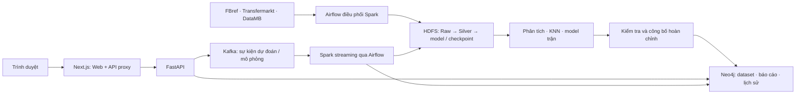

# Premier League Analyst 2022–2025

Hệ thống phân tích Premier League, gộp pipeline chuẩn hóa, KNN và dự đoán trận với logic từ `football_analysis_share` và `Danh`. Web Next.js gọi API FastAPI; dữ liệu và báo cáo đã công bố được phục vụ từ Neo4j. HDFS giữ lakehouse, artifact model và checkpoint streaming.

## 1. Kiến trúc tổng thể



| Thành phần | Vai trò | Mã chính |
| --- | --- | --- |
| Frontend | Dashboard trắng–xanh, bộ lọc, biểu đồ, dự đoán và lịch sử | `Premier Leauge Club Analyst/web-next/` |
| Backend | API Neo4j, dự đoán trận, định giá, tương đồng và mô phỏng | `Generate_LeagueTable_Api/analystic/match_outcome/api.py`, `analytics/api.py` |
| Spark | Chuẩn hóa Raw/Silver, phân tích batch, huấn luyện và xử lý sự kiện | `jobs/`, `analytics/`, `Generate_LeagueTable_Api/` |
| Airflow | Điều phối pipeline và consumer Kafka, trạng thái lần chạy thực | `portable/airflow/dags/football.py`, `portable/runtime.py` |
| Kafka | Sự kiện dự đoán, chuyển nhượng và chuẩn hóa giải đấu | `match_outcome/stream.py`, `analytics/streaming.py` |
| Neo4j | Nguồn, Silver, DataMB, audit, báo cáo, đầu vào/kết quả phân tích | `analytics/store.py`, `analytics/ingest.py`, `analytics/publish.py` |
| HDFS | Lakehouse, model version, checkpoint và dữ liệu replay | `jobs/pl_pipeline/`, `portable/hdfs` |

Kafka, Airflow, Neo4j và Hadoop là **hạ tầng ngoài đã có**. Compose production chỉ đóng gói API/Web/runtime. Script mã nguồn trong `scripts/` dùng `docker start` cho container Kafka/Airflow hiện có, không build/pull image, tạo container hoặc tạo Hadoop.

## 2. Dữ liệu và chức năng

- Ba mùa 2022/23–2024/25: **1.140 trận, 2.280 đội–trận, 60 đội–mùa, 240 giai đoạn**, 3.445 bàn thắng đã đối chiếu tỉ số.
- **21 bảng Silver, 73.075 dòng**; **1.350 bản ghi DataMB**. Các ID DataMB trùng được giữ cùng nguồn gốc, không gộp mất bản ghi.
- Tổng quan, bảng xếp hạng/KNN, hồ sơ và so sánh CLB, phong độ bốn giai đoạn, tiềm năng/rủi ro cầu thủ theo cửa sổ 1–3 mùa.
- Spark SQL chuyển nhượng, thu–chi, hiệu quả chi tiêu, RFM/GMM thật; nhóm theo ngưỡng được đặt tên phương pháp riêng.
- Radar/cosine cầu thủ, định giá/quỹ đạo, mô phỏng chuyển nhượng có nhãn tách dữ liệu thật.
- Dự đoán trước và trong trận, lịch sử đối đầu, trận tương đồng và yếu tố ảnh hưởng.

Schema, khóa và checksum nằm trong `data/`; nguồn gộp ghi tại [integration_manifest.json](data/integration_manifest.json). JSON giữ phân biệt `null`, chuỗi rỗng và số 0; DECIMAL được giữ bằng chuỗi chính xác.

## 3. Cấu trúc project

```text
.
├── analytics/                          # Logic chung, serving và publication Neo4j
├── data/                               # Manifest, Silver CSV, DataMB, nguồn nén
├── FBref_Data/                         # Nguồn FBref
├── Transfermark_Data/                  # Nguồn Transfermarkt
├── jobs/                               # Raw → identity → Silver → audit
├── Generate_LeagueTable_Api/
│   ├── analystic/knn/                  # Bảng xếp hạng và láng giềng KNN
│   └── analystic/match_outcome/        # FastAPI, model v1/v2, inference, streaming
├── Premier Leauge Club Analyst/
│   └── web-next/                      # Next.js, React, biểu đồ và proxy API
├── scripts/                            # Chạy từng dịch vụ / toàn bộ Windows/Linux
├── portable/                           # Dockerfile, Compose, dependency lock, seed, DAG
├── infra/                              # Đóng gói, xuất seed, giải nén nguồn
├── tests/                              # Unit, Database/Kafka, trình duyệt
├── validation/                         # Phương pháp, số liệu, giới hạn nghiệm thu
└── .github/workflows/ci.yml             # Build, test, ZIP và SHA256
```

## 4. Chạy frontend, backend, Kafka và Airflow

### Chuẩn bị một lần

Chạy mã nguồn bằng Python **3.11**, Node.js **>=20.9**, Docker engine hoạt động và container Kafka/Airflow đã có. Runtime phân tích đóng gói dùng Java **17**, Spark **3.5.1**, Scala **2.12**, Kafka connector tương ứng và Airflow **3.3.2**. Dependency khóa trong `portable/requirements-*.txt` và `web-next/package-lock.json`.

Windows PowerShell, tại root repository:

```powershell
# Chỉ tạo .env nếu chưa có; giữ cấu hình và mật khẩu hiện tại.
if (-not (Test-Path portable/.env)) { Copy-Item portable/.env.example portable/.env }
py -3.11 -m venv .venv
.venv\Scripts\Activate.ps1
python -m pip install -r portable/requirements-api.txt
Push-Location 'Premier Leauge Club Analyst/web-next'
npm ci
Pop-Location
```

Linux/WSL:

```bash
test -f portable/.env || cp portable/.env.example portable/.env
python3.11 -m venv .venv
source .venv/bin/activate
python -m pip install -r portable/requirements-api.txt
(cd 'Premier Leauge Club Analyst/web-next' && npm ci)
```

Chỉnh `portable/.env` theo dịch vụ thực tế. Mật khẩu Neo4j chỉ lưu ở file này, không commit. `NEO4J_HTTP_URI`, `KAFKA_BOOTSTRAP_SERVERS`, `HDFS_URI` dùng cho runtime/container; launcher trên host hỗ trợ override `LOCAL_NEO4J_HTTP_URI`, `LOCAL_KAFKA_BOOTSTRAP_SERVERS`, `LOCAL_HDFS_URI`, `LOCAL_NAMENODE_HTTP_URI`, `LOCAL_FOOTBALL_API_URL`. Nếu không override, launcher đổi `host.docker.internal` thành `127.0.0.1`, giữ nguyên cổng và các địa chỉ khác. Kafka phải khớp **published port và advertised listeners**; `plca-kafka` trên máy tác giả dùng host port **29092**.

`KAFKA_CONTAINER` và `AIRFLOW_CONTAINERS` chọn tên container hiện có. Airflow theo thứ tự PostgreSQL → Redis → API server → scheduler → DAG processor → triggerer → worker. Không đưa container `airflow-init`/`kafka-init` vào danh sách chạy. Máy khác phải sửa tên theo executor và container của mình. Script kiểm tra toàn bộ tên trước khi khởi động, chờ healthcheck nếu có và báo lỗi nếu thiếu hoặc không sẵn sàng.

### Script Windows / Linux

| Dịch vụ | PowerShell | Bash |
| --- | --- | --- |
| Frontend | `./scripts/start-frontend.ps1` | `bash scripts/start-frontend.sh` |
| Backend | `./scripts/start-backend.ps1` | `bash scripts/start-backend.sh` |
| Kafka hiện có | `./scripts/start-kafka.ps1` | `bash scripts/start-kafka.sh` |
| Airflow hiện có | `./scripts/start-airflow.ps1` | `bash scripts/start-airflow.sh` |
| Toàn bộ | `./scripts/start-all.ps1` | `bash scripts/start-all.sh` |

Các wrapper dùng cùng `scripts/run.py`; có thể gọi trực tiếp:

```bash
python scripts/run.py all --check
python scripts/run.py all
python scripts/run.py backend --api-port 8001
python scripts/run.py frontend --api-port 8001 --web-port 3001
```

`--check` chỉ kiểm tra dependency, cấu hình, cổng và container; không tạo tiến trình, khởi động dịch vụ hay kiểm tra xác thực Database. Script chạy được từ thư mục làm việc khác; mặc định tìm `.env` theo root project. `--env-file` chọn đường dẫn tương đối root hoặc tuyệt đối; biến môi trường shell ưu tiên hơn file. `PL_PYTHON_BIN` chọn Python của venv nếu cần. Nếu PowerShell chặn script, gọi `python scripts/run.py ...` trực tiếp.

Frontend/backend chạy foreground trong terminal. **Ctrl+C** dừng các tiến trình ứng dụng do script đó tạo; container hạ tầng tiếp tục chạy. `all` dừng ứng dụng còn lại nếu một ứng dụng thoát. Script không tự cài dependency, nhập dữ liệu, huấn luyện, trigger DAG hoặc thay đổi Database. Frontend production cần `npm run build`, sau đó thêm `--production`.

Mặc định Web: **http://127.0.0.1:3000**, API docs: **http://127.0.0.1:8000/docs**. `API_PORT`/`WEB_PORT` đổi cổng; script báo lỗi khi cổng đã được dùng. Airflow UI dùng cổng container đã publish, trên máy tác giả là **http://127.0.0.1:8081**. Neo4j Desktop được mở riêng. API cần dataset/báo cáo đã công bố; `/health` trả 503 khi Database hoặc publication chưa sẵn sàng.

### Gói Docker và DAG Airflow

[Hướng dẫn triển khai](portable/README_VI.md) mô tả Compose ứng dụng, mạng HDFS/DataNode và mount project/DAG vào Airflow hiện có. `portable/start.ps1` / `portable/start.sh` chạy **gói ứng dụng Docker**, có thể tạo container ứng dụng và chạy publication; chỉ dùng khi chọn cách triển khai đó. Build ứng dụng là lựa chọn riêng, không phải hành vi của `scripts/start-*`.

Khởi động Airflow không đồng nghĩa đã cài DAG project. Worker/DAG processor cần `portable/airflow/dags`, mã project tại `/opt/project`, runtime Spark/JAR, biến môi trường và pool `spark_serial` theo hướng dẫn. Script giữ nguyên mount, command và credential của container hiện có.

## 5. Pipeline, Database và replay

`football_pipeline`: preflight → snapshot nguồn → identity → Silver → validate → publish Silver → KNN → model trận v1 → đặc trưng/huấn luyện/hiệu chỉnh/đánh giá v2 → lưu artifact → công bố Neo4j.

`football_kafka_analytics`: chuẩn hóa giải đấu → dự đoán trận → mô phỏng chuyển nhượng. Checkpoint bền vững; khóa sự kiện và checksum ngăn ghi trùng. Sự kiện v2 giữ model version/mốc dữ liệu; consumer vẫn nhận v1. HDFS được ghi trước Neo4j và checkpoint.

Neo4j có `PLDataset`, `PLTable`, `PLRecord`, `PLRun`, `PLReport`, `PLActive`, `PLEvent`, `PLJob`. Pointer chỉ đổi trong transaction hoàn tất sau khi đủ báo cáo. Run lỗi không thay thế bản tốt. Đầu vào, feature, láng giềng, xác suất và model version được lưu trước khi API báo thành công. Database lỗi trả 503 và Web hiển thị lỗi lưu.

## 6. API và dự đoán trận

| Endpoint | Nội dung |
| --- | --- |
| `/health`, `/docs` | Trạng thái phục vụ và tài liệu API |
| `/matches`, `/knn/*` | Dữ liệu trận và báo cáo KNN |
| `POST /predict` | API dự đoán v1 tương thích |
| `/prediction/config`, `POST /predict/v2` | Dự đoán trước/trong trận, tỉ số/phút/thống kê tùy chọn |
| `/model/metrics/v2` | Đánh giá model và độ tin cậy |
| `/dashboard`, `/outlook`, `/phases`, `/transfers`, `/rfm/{method}` | Báo cáo phân tích |
| `/players`, `/players/similar`, `POST /valuation` | Cầu thủ, tương đồng, định giá |
| `POST /transfers/simulate`, `/streaming/transfers` | Mô phỏng và sự kiện đã xử lý |
| `/reports`, `/reports/{run_id}/{kind}`, `/pipeline`, `/data/catalog`, `/data/rows` | Lịch sử, pipeline và danh mục Database |

Trước trận chỉ dùng lịch sử **trước ngày dự đoán**, tối đa ba mùa: Poisson regularized, phong độ, sân nhà/khách, đối đầu có shrinkage và cosine. Trong trận bổ sung tỉ số, phút/bù giờ; trường trống không bị coi là 0. Phút 0, tỉ số 0–0, chưa nhập thống kê trả kết quả trước trận; chọn **Đã kết thúc** trả 100% theo tỉ số. Phút 90 không tự kết thúc.

Dữ liệu đến **25/05/2025**, ngày dự đoán mặc định **26/05/2025**, không phải dữ liệu live. Trên 380 trận mùa 2024/25: trước trận accuracy **51,3%**, baseline **40,8%**, model chỉ lịch sử **50,8%**; tỉ số/phút **70,8%** trên 9 trạng thái mỗi trận. Nhận diện hòa trước trận còn yếu. Thống kê nhập so với thống kê tổng kết, chưa kiểm chứng bằng dữ liệu trực tiếp theo phút. Xem [phương pháp và giới hạn](validation/FORECAST_V2.md).

## 7. Kiểm thử, CI/CD và bàn giao

```bash
export PYTHONPATH="$PWD:$PWD/Generate_LeagueTable_Api/analystic"
python -m unittest discover -s tests -v
python -m unittest discover -s Generate_LeagueTable_Api/analystic/match_outcome/tests -v
python -m analytics.outlook.verify_outlook
python -m analytics.outlook.verify_club_phases
python infra/package_portable.py
python portable/verify_bundle.py --archive artifacts/PremierLeague_Docker.zip
```

GitHub [Actions](https://github.com/DuyLinh0212/Premier-League-Analyst-22-25/actions) kiểm tra Compose, huấn luyện theo thời gian, build API/Web/runtime, unit, DAG import, Neo4j/Kafka thật, replay, mất Database/restart và Web sau khi bỏ báo cáo cục bộ. CI được phép tạo hạ tầng tạm; không chạy `compose.ci.yaml` để dựng thêm hạ tầng trên máy người dùng. Artifact `PremierLeague-verified-delivery` có ZIP, SHA256 và screenshot nghiệm thu.

ZIP gồm mã nguồn, script chạy, seed, model, dependency lock và manifest checksum; loại secret, cache, image tar và archive Hadoop. Đóng gói tìm root theo vị trí script, không tạo `delivery/delivery`. `appearances.csv.gz` được giải nén và kiểm tra checksum khi import/build.

Nghiệm thu HDFS thật và container hiện có ghi ở [validation/README.md](validation/README.md). Neo4j local cần credential của instance hiện có; CI thành công không đồng nghĩa đã nạp Database local. Giải nén/chạy từ đường dẫn khác đã kiểm tra; triển khai trên máy nhận riêng chưa kiểm chứng thực tế.

## 8. Tài liệu liên quan

- [Triển khai với hạ tầng ngoài](portable/README_VI.md)
- [Dự đoán trước và trong trận](validation/FORECAST_V2.md)
- [Dữ liệu Silver](data/silver/README_VI.md)
- [Công cụ đóng gói](infra/README.md)
- [Evidence và giới hạn](validation/README.md)

Giấy phép: [LICENSE](LICENSE).
